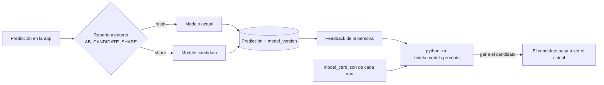

# A/B testing y promoción del modelo

Cómo probar un modelo nuevo con personas usuarias reales sin retirar el actual, y cómo decidir si lo sustituye (issue #37, nivel experto del briefing). Complementa el flujo MLOps de la #16: versiones y [contrato del modelo](model-contract.md), [data drift](drift.md) y [datos para reentrenar](retraining.md).

Código: [`src/kiniela/models/ab_testing.py`](../src/kiniela/models/ab_testing.py) (reparto y regla) y [`src/kiniela/models/promote.py`](../src/kiniela/models/promote.py) (script).

## Las piezas

| Archivo en `models/` | Qué es |
| --- | --- |
| `kiniela_model.joblib` + `model_card.json` | Modelo **actual**. Sin él, la app usa el modelo de prueba |
| `candidate_model.joblib` + `candidate_model_card.json` | Modelo **candidato**, opcional. Cumple el mismo [contrato](model-contract.md) y tiene que tener otra `version` |
| `archive/<versión>/` | Modelos sustituidos, por si hay que volver atrás |

| Variable de entorno | Valor | Efecto |
| --- | --- | --- |
| `AB_CANDIDATE_SHARE` | Número de 0 a 1. Sin definir = 0 | Parte de las predicciones que responde el candidato. Con `0.5`, la mitad |

## Cómo funciona



1. **Reparto.** En cada predicción, la app elige el candidato con probabilidad `AB_CANDIDATE_SHARE`, y el resto de veces el actual. Es aleatorio por predicción, así el tráfico se reparte en la proporción pedida aunque se repitan los partidos. El generador usa la semilla `RANDOM_STATE` de `config.py`, como todo lo aleatorio del proyecto.
2. **Registro.** Cada predicción guarda su `model_version` (columna que ya existía, ver [base de datos](database.md)). La página Predecir muestra con qué modelo se ha predicho.
3. **Medida.** Con el feedback se calcula el acierto real de cada versión. La página **Historial** muestra una tabla *A/B testing* con las dos versiones: F1 macro y gap de validación (de su ficha), predicciones, predicciones con feedback y acierto.
4. **Decisión.** El script aplica la regla y, si el candidato gana, lo promociona.

## Regla de promoción

El candidato sustituye al actual **solo si se cumplen las cuatro condiciones**. Los umbrales son constantes al principio de `ab_testing.py`.

| # | Condición | Umbral | Por qué |
| --- | --- | --- | --- |
| 1 | La ficha del candidato tiene `f1_macro` y `overfitting_gap`, y el gap es menor que el máximo | `MAX_OVERFITTING_GAP = 0.05` | Regla del proyecto: gap train/validación < 0,05 |
| 2 | Su F1 macro de validación supera al del actual en al menos el margen | `MIN_F1_IMPROVEMENT = 0.01` | F1 macro es la métrica declarada (clases desbalanceadas). El margen evita cambiar de modelo por ruido |
| 3 | Las dos versiones tienen suficientes predicciones con feedback | `MIN_FEEDBACK = 30` | Con pocos datos el acierto real no es fiable |
| 4 | Su acierto según el feedback no es menor que el del actual | — | Que sea mejor en validación y no empeore con partidos reales |

Si el actual es el **modelo de prueba** (no tiene ficha), la condición 2 no se puede comparar: se omite y el script lo dice. El resto se aplica igual.

El script siempre explica cada condición que falla, así se sabe qué falta (por ejemplo, más feedback).

## Ficha del modelo

La regla lee estas claves de `model_card.json` (y de `candidate_model_card.json`). El resto de campos del [contrato](model-contract.md) se pueden añadir sin problema.

```json
{
  "version": "lgbm-2026-11-20",
  "metrics": {
    "f1_macro": 0.41,
    "overfitting_gap": 0.03
  }
}
```

- `version` tiene que ser igual que la `version` del modelo guardado; si no, el script se para.
- `f1_macro`: F1 macro de validación, con el mismo `StratifiedKFold` y `RANDOM_STATE` que el resto de modelos.
- `overfitting_gap`: F1 macro de train menos F1 macro de validación.

## Paso a paso

1. **Preparar el candidato.** Guarda el modelo nuevo como `models/candidate_model.joblib` y su ficha como `models/candidate_model_card.json`.
2. **Activar el A/B testing.** En local: `AB_CANDIDATE_SHARE=0.5 streamlit run app/streamlit_app.py`. En Render: añade `AB_CANDIDATE_SHARE` en *Environment*, sube los archivos del candidato con un PR y lanza *Manual Deploy*. Los archivos del candidato ya entran en la imagen (`.dockerignore`).
3. **Esperar feedback.** Hasta que las dos versiones tengan al menos 30 predicciones con feedback. Se sigue en la página Historial.
4. **Ver la decisión sin tocar nada**, desde la raíz del repo y con `DATABASE_URL` apuntando a la base de datos de producción:

   ```bash
   PYTHONPATH=src python -m kiniela.models.promote --dry-run
   ```

5. **Promocionar.** Sin `--dry-run`, si la regla lo permite, el script mueve el modelo actual a `models/archive/<versión>/` y el candidato pasa a llamarse `kiniela_model.joblib` / `model_card.json`.
6. **Publicar.** Sube los archivos con un PR a `dev`, pon `AB_CANDIDATE_SHARE` a 0 (ya no hay candidato) y lanza *Manual Deploy* en Render.

Ejemplo de salida:

```text
Current: lgbm-2026-11-20 | Candidate: lgbm-2026-12-01
- 'lgbm-2026-12-01' has 12 predictions with feedback; 30 are needed.
Not promoted.
```

## Por qué la promoción no cambia la app en marcha

En Render, los modelos viajan **dentro de la imagen Docker** y el disco del contenedor se borra en cada despliegue. Si el script cambiara los archivos dentro del contenedor, el cambio se perdería y nadie lo habría revisado. Por eso la decisión es automática, pero la publicación pasa por el mismo camino que cualquier cambio: PR a `dev`, CI en verde y despliegue. Así cada cambio de modelo queda en el historial de Git y se puede deshacer recuperando la versión de `models/archive/`.

## Límites

- Mientras no exista el modelo final (#35), solo se puede probar con modelos de prueba. Los tests usan modelos falsos con el mismo contrato.
- El reparto es por predicción, no por persona: una misma persona puede ver predicciones de los dos modelos. Para un producto con cuentas de usuario, se repartiría por persona.
- Los umbrales (`0.01`, `0.05`, `30`) son una propuesta: si el equipo acuerda otros, se cambian en `ab_testing.py` y en esta tabla.
