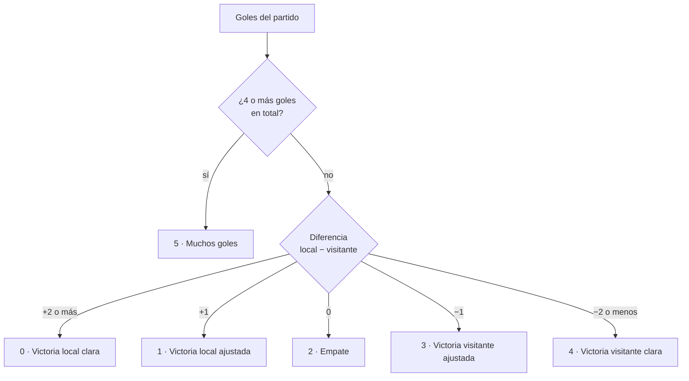

# 2. Datos, variable objetivo y EDA

**Autora:** Anna · **Issues:** #1, #2 y #4 · **Estado a 16/11/2026**

Esta sección explica de dónde salen los partidos, cómo se convierte cada resultado en una de las 6 clases y qué dice el análisis exploratorio sobre cómo modelarlas. El EDA se hizo sobre la temporada 2023-24; el modelo final (#66) se entrena con 9 temporadas, de 2015-16 a 2023-24.

## 2.1 Fuente y preparación (#1)

| | |
| --- | --- |
| Fuente | [football-data.co.uk](https://www.football-data.co.uk/), archivo `E0` (Premier League) |
| Temporada del EDA | 2023-24: 380 partidos, 20 equipos, del 11/08/2023 al 19/05/2024 |
| Temporadas del modelo final | 2015-16 a 2023-24: 3.420 partidos, 33 equipos |
| Código | `download_premier_league_data()` en [`src/kiniela/data/dataset.py`](../../src/kiniela/data/dataset.py) |
| CSV en bruto | `data/raw/premier_league_2324_raw.csv` (EDA) y `data/raw/premier_league_1516_2324.csv` (modelo final) |
| CSV procesado | `data/processed/premier_league_2023_24.csv` |

Ninguno de los CSV se sube al repositorio (`data/raw/` y `data/processed/` están en `.gitignore`). Los de 2023-24 se regeneran con la función de descarga; los pasos están en [`docs/tarea-preparacion-dataset.md`](../tarea-preparacion-dataset.md).

**Limpieza.** Se descartan las filas sin equipos, goles o resultado y las filas duplicadas, se pasan los nombres de los equipos a minúsculas (`"Man City"` → `"man city"`, el formato que usa la app) y se ordena por fecha. En 2023-24 el archivo venía completo: no se perdió ningún partido.

**Qué se usa.** El CSV conserva las 106 columnas del original (estadísticas del partido, cuotas de apuestas…), pero el proyecto solo usa seis: `Date`, `HomeTeam`, `AwayTeam`, `FTHG` y `FTAG` (goles del local y del visitante) y `FTR` (resultado: H, D o A). Las estadísticas del partido no pueden ser features porque se conocen después del partido (ver la sección 3).

**Fechas.** El CSV guarda la fecha como texto `dd/mm/aaaa`. Antes de ordenar hay que convertirla a fecha: ordenada como texto, el 01/09/2023 quedaría antes que el 11/08/2023.

**Una temporada para el EDA, nueve para el modelo.** El EDA y las cifras de esta sección son de 2023-24, salvo donde se indica. Con una sola temporada las clases pequeñas tenían muy pocos ejemplos (ver 2.4), así que el modelo final se entrena con las 9 temporadas de 2015-16 a 2023-24. Las descarga y guarda una copia en `data/raw/premier_league_1516_2324.csv`, desde la raíz del repositorio:

```bash
PYTHONPATH=src python -m kiniela.models.final
```

## 2.2 Variable objetivo (#2)

`build_target(home_goals, away_goals)` ([`src/kiniela/data/target.py`](../../src/kiniela/data/target.py)) asigna la clase con un orden fijo:



- **La clase 5 va primero.** Un partido con 4 o más goles es clase 5 aunque sea un empate (2-2) o una victoria clara (4-0). Por eso no hay partidos de clase 0 o 4 con más de 3 goles: un 3-0 es clase 0, pero un 4-0 es clase 5.
- **Umbral de 2 goles** entre victoria clara y ajustada. Con un umbral de 3, y la clase 5 por delante, la victoria clara quedaría reducida al 3-0 y al 0-3.
- Los nombres de las clases están en `CLASS_NAMES` ([`src/kiniela/config.py`](../../src/kiniela/config.py)), el único sitio donde se definen.
- La regla está cubierta por 18 tests en [`tests/test_target.py`](../../tests/test_target.py), incluidos los casos límite (0-4, 2-2, 3-1, diferencia exacta de 2).

## 2.3 Distribución de clases

| Clase | Nombre | 2023-24 (EDA) | % | 2015-16 a 2023-24 (modelo) | % |
| --- | --- | --- | --- | --- | --- |
| 0 | Victoria local clara | 42 | 11,1 | 415 | 12,1 |
| 1 | Victoria local ajustada | 53 | 13,9 | 589 | 17,2 |
| 2 | Empate | 49 | 12,9 | 583 | 17,0 |
| 3 | Victoria visitante ajustada | 44 | 11,6 | 472 | 13,8 |
| 4 | Victoria visitante clara | 26 | 6,8 | 271 | 7,9 |
| 5 | Muchos goles (4+) | 166 | **43,7** | 1.090 | **31,9** |
| | **Total** | 380 | | 3.420 | |

**2023-24.** La clase 5 es 6,4 veces la clase 4. En esta temporada hubo 3,28 goles por partido (1,80 del local y 1,48 del visitante), así que casi la mitad de los partidos llega a 4 goles. En resultados, el local ganó el 46,1 %, hubo empate en el 21,6 % y ganó el visitante en el 32,4 %; las clases 0-4 quedan por debajo porque la clase 5 se queda con todos los partidos de muchos goles.

**Las 9 temporadas.** Hubo 2,82 goles por partido (1,56 del local y 1,26 del visitante): local 44,9 %, empate 23,2 % y visitante 31,9 %. La clase 5 baja al 31,9 % y pasa a ser 4,0 veces la clase 4. 2023-24 fue una temporada de muchos goles, la que más de las 9, así que su distribución exagera el peso de la clase 5.

## 2.4 Conclusiones del EDA (#4)

El análisis completo está en [`notebooks/01_eda.ipynb`](../../notebooks/01_eda.ipynb), que solo llama al código de `src/kiniela/`. Lo que importa para el modelado:

1. **La accuracy engaña.** Un modelo que siempre dijera «clase 5» acertaría el 43,7 % en 2023-24 (el 31,9 % con las 9 temporadas). Por eso se valida con `StratifiedKFold` (mantiene la proporción de clases en cada fold) y los modelos se comparan con **F1 macro**, que pesa igual todas las clases.
2. **La frontera de la clase 5 es estrecha.** Hay 80 partidos con 3 goles y otros 80 con 4: un gol decide si un partido es clase 5 o una de las otras. Es la clase más frecuente, pero no la más fácil de predecir antes del partido.
3. **Las features separan poco las clases.** Con los 359 partidos que tienen historial, las medias de las features por clase se parecen mucho. La señal más clara está entre victoria local y visitante (`match_diff`: 0,44 de media en la clase 0 y −0,02 en la clase 4); la clase 5 apenas se distingue. Hay que esperar un F1 macro bajo.
4. **Pocos datos para las clases pequeñas.** La clase 4 tiene 26 partidos en toda la temporada 2023-24. Por eso el modelo final se entrena con 9 temporadas (271 partidos de clase 4), y el resultado lo confirma. Con una temporada, el mejor modelo no superaba al modelo de prueba (F1 macro 0,095 frente a 0,102). Con 9 temporadas llega a 0,172 frente a 0,080 (#66).

El detalle de las features y de la correlación entre ellas está en la [sección 3](03-features.md).
