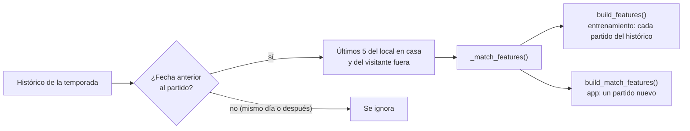

# 3. Feature engineering y control de fuga de datos

**Autora:** Anna · **Issues:** #3 y #34 · **Estado a 16/11/2026** (describe el código de la PR #58)

El modelo no puede ver el resultado del partido que predice, así que necesita variables calculadas **antes** del partido: cómo llega cada equipo. Esta sección explica qué variables se crearon, cómo se garantiza que solo usan el pasado y cómo la app calcula exactamente las mismas para un partido nuevo.

## 3.1 Variables

Todas se calculan con los **últimos 5 partidos anteriores de la temporada en la misma condición**: el local, con sus partidos en casa; el visitante, con sus partidos fuera. La localía pesa en el fútbol (en 2023-24 el local ganó el 46,1 % de los partidos y el visitante el 32,4 %), y un equipo puede rendir muy distinto en casa y fuera.

| Variable | Qué mide |
| --- | --- |
| `form_home_last_5`, `form_away_last_5` | Media de los 5 resultados desde el punto de vista del equipo: victoria = 1, empate = 0, derrota = -1 |
| `avg_home_goals_last_5`, `avg_away_goals_last_5` | Media de goles marcados |
| `home_diff_last_5`, `away_diff_last_5` | Media de la diferencia de goles (marcados − encajados) |
| `match_diff` | `form_home_last_5 − form_away_last_5`: quién llega mejor |
| `match_goals_expected` | `avg_home_goals_last_5 + avg_away_goals_last_5`: cuántos goles cabe esperar (la clase 5 depende del total de goles) |

La lista y su orden están en `FEATURE_COLUMNS` ([`engineering.py`](../../src/kiniela/features/engineering.py)). Se usan 5 partidos porque es lo bastante corto para reflejar la racha y lo bastante largo para no depender de un solo resultado.

**Por qué 8 y no 11.** La primera versión (#3) tenía además `recent_home_form`, `recent_away_form` y `match_momentum`. En la #34 se eliminaron porque repetían información de las anteriores.

## 3.2 Control de la fuga de datos

- **Solo partidos con fecha anterior.** Para cada partido se filtran los de fecha estrictamente menor; los del mismo día tampoco cuentan.
- **Fechas convertidas antes de ordenar.** El CSV trae las fechas como `dd/mm/aaaa`. Ordenadas como texto, el 01/09/2023 quedaría antes que el 11/08/2023 y entrarían partidos futuros en el «pasado». Por eso se convierten a fecha antes de nada.
- **El historial se reinicia cada temporada.** El modelo final se entrena con 9 temporadas (#66), y cada una empieza sin historial.
- **Sin historial, sin valor.** Si un equipo aún no ha jugado en esa condición, sus variables quedan vacías (`NaN`). Esos partidos, de las primeras jornadas, se descartan al entrenar. En 2023-24 son 21 de 380 (quedan 359). Con las 9 temporadas del modelo final son 185 de 3.420 (quedan 3.235).

## 3.3 Features de un partido nuevo (#34)

La app tiene que predecir partidos que aún no se han jugado. `build_match_features(history, home_team, away_team)` calcula sus variables con todo el histórico de la última temporada y devuelve una tabla de una fila con las columnas de `FEATURE_COLUMNS`, lista para `predict_proba` (ver el [contrato del modelo](../model-contract.md)).

Lo importante es que la app calcule **exactamente** lo mismo que vio el modelo al entrenar. La primera versión no lo hacía: al compararla con partidos reales salían valores distintos (la forma siempre vacía, un partido de menos en las medias y el signo de la forma del visitante invertido). La corrección fue hacer que `build_features` y `build_match_features` llamen a la misma función, `_match_features`, en lugar de tener dos cálculos parecidos.

## 3.4 Validación

Los tests están en [`tests/test_features.py`](../../tests/test_features.py) (21 tests). Los más importantes:

| Test | Qué garantiza |
| --- | --- |
| `test_matches_the_training_features` | Para cada partido de una temporada simulada, la app calcula lo mismo que el entrenamiento |
| `test_changing_a_result_does_not_change_its_own_features` | No hay fuga: cambiar el resultado de un partido no cambia sus propias variables ni las anteriores |
| `test_matches_on_the_same_day_do_not_see_each_other` | Los partidos del mismo día no se ven entre sí |
| `test_day_first_dates_are_sorted_chronologically` | Las fechas `dd/mm/aaaa` se ordenan por fecha, no como texto |
| `test_form_is_the_mean_of_the_last_5_results` | La forma es la media de 5 resultados, no solo el último |
| `test_away_win_counts_as_a_win_for_the_away_team` | Una victoria fuera suma para el visitante |

Además, con el CSV real de 2023-24, las variables de la app coinciden con las de entrenamiento en los 380 partidos. Si se vuelve a meter la fuga (`<=` en lugar de `<`), fallan 9 tests: 8 de las features y el de la descarga que comprueba que el historial se reinicia en cada temporada.

## 3.5 Qué dice el EDA de estas variables

Del [notebook de EDA](../../notebooks/01_eda.ipynb) (#4), con los 359 partidos que tienen todas las variables:

- **Separan poco las clases.** La diferencia más clara está entre victoria local y visitante: `match_diff` vale 0,44 de media en la clase 0 y −0,02 en la clase 4. Para la clase 5, `match_goals_expected` (3,28) apenas se distingue de la media general (3,22).
- **Algunas van casi juntas.** La forma y la diferencia de goles del mismo equipo tienen una correlación de Spearman de 0,92 (en casa) y 0,89 (fuera). Los árboles lo toleran; un modelo lineal necesitaría regularización.

## 3.6 Límites

- **El EDA es de una sola temporada.** Las cifras de 3.5 salen de los 359 partidos útiles de 2023-24, donde la clase 4 tiene solo 26 ejemplos. Ese era el principal límite. El modelo final (#66) ya se entrena con 9 temporadas, de 2015-16 a 2023-24 (3.235 partidos con historial), y así su F1 macro pasa de 0,095 a 0,172 (ver la sección 2.4). Siguen siendo solo partidos de la Premier League.
- **Solo resultados y goles.** No hay variables de tiros, lesiones, alineaciones ni descanso entre partidos.
- **Las primeras jornadas no se pueden predecir bien.** Sin partidos previos en la temporada, las variables quedan vacías.
