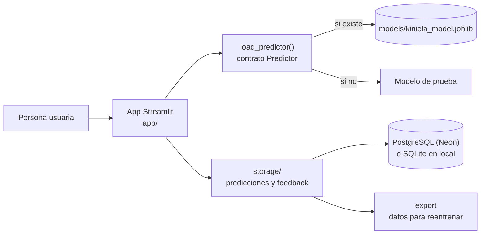
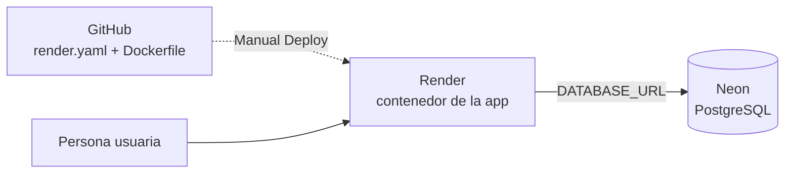

# 6. Aplicación, base de datos y despliegue

**Autora:** Eva (App & Backend Lead) · **Issues:** #9, #10, #11, #12 y #36 · **Estado a 13/11/2026**

Esta parte convierte el modelo en un producto: una aplicación web que cualquiera puede usar para predecir la clase de un partido, que guarda cada predicción y la opinión de quien la usa, y que está desplegada en la nube.

**App en producción:** https://kiniela-predictor.onrender.com

## 6.1 Arquitectura



| Capa | Dónde | Qué hace |
| --- | --- | --- |
| Interfaz | `app/` | Solo pantalla: dos páginas (Predecir e Historial), con caché de recursos |
| Predicción | `src/kiniela/models/predict.py` | Contrato `Predictor`, carga del modelo y modelo de prueba |
| Catálogo | `src/kiniela/data/catalog.py` | Equipos y clases del dataset, con valores de respaldo |
| Persistencia | `src/kiniela/storage/` | Conexión, tablas, operaciones y export para reentrenar |
| Empaquetado | `Dockerfile`, `docker-compose.yml` | Imagen de la app y entorno local con PostgreSQL |
| Despliegue | `render.yaml` | Servicio web en Render (infraestructura como código) |

La regla de diseño es que **la interfaz no contiene lógica**: todo lo reutilizable vive en `src/kiniela/`. Así lo prueban los tests sin abrir la app, y no se duplica código.

## 6.2 Aplicación (#9)

La persona elige el equipo local y el visitante (o un partido de ejemplo) y la app muestra:

- la **clase predicha** (0-5) con su nombre;
- una tabla con las **6 probabilidades**;
- un formulario de **feedback**: acertó o falló, la clase real si la sabe, y un comentario.

La página **Historial** muestra las últimas 50 predicciones con su feedback, y el **acierto en tiempo real** según ese feedback, para el modelo actual y para todos.

### El contrato del modelo

La app se construyó antes de que existiera el modelo entrenado. Para no depender de él, solo exige un **contrato** (`Protocol` de Python):

```python
class Predictor(Protocol):
    version: str
    def predict(self, home_team: str, away_team: str) -> list[float]: ...  # 6 probabilidades
```

`load_predictor()` carga `models/kiniela_model.joblib` si existe y, si no, un **modelo de prueba** que devuelve el reparto de clases observado en el dataset (por ejemplo, 43,7 % para la clase 5). La app lo indica con un aviso visible. Cuando el modelo final cumpla el contrato (#35, [`docs/model-contract.md`](../model-contract.md)), se conectará **sin cambiar el código de la app**.

### Robustez

| Situación | Comportamiento |
| --- | --- |
| Falta un equipo, o el mismo equipo dos veces | Mensaje claro; no predice ni guarda nada |
| La base de datos no responde | La predicción se muestra igualmente, con un aviso de que no se ha guardado |
| No hay dataset (por ejemplo, en Docker) | Lista de respaldo de 20 equipos y reparto de clases guardado |
| El modelo guardado no cumple el contrato | Mensaje de error, sin romper la app |

La validación de equipos está **una sola vez**, en `src/`, y la comparten la app y la base de datos.

## 6.3 Base de datos y feedback (#11)

SQLAlchemy 2 con dos tablas:

| Tabla | Columnas clave | Por qué |
| --- | --- | --- |
| `predictions` | `inputs` (JSON), `predicted_class`, `prob_0`…`prob_5`, `model_version` | Las probabilidades en columnas permiten agregarlas en SQL; `model_version` permite comparar modelos (A/B testing) |
| `feedback` | `prediction_id` (único), `is_correct`, `actual_class`, `comment` | Un solo veredicto por predicción; `actual_class` es la etiqueta para reentrenar |

- La conexión sale de la variable de entorno **`DATABASE_URL`**: PostgreSQL en Neon en producción y SQLite en local y en los tests. **No hay credenciales en el repositorio.**
- Cada operación va en una transacción (`session_scope`): si algo falla, no queda nada a medias.
- `feedback_stats()` calcula el acierto según el feedback, en total y por versión de modelo.

Detalle completo: [`docs/database.md`](../database.md).

## 6.4 Datos para reentrenar (#36)

`python -m kiniela.storage.export` añade a `data/raw/feedback/labelled_matches.csv` los partidos cuyo feedback incluye la **clase real**. Lo hace con las columnas del dataset histórico (`HomeTeam`, `AwayTeam`, `Date`) y la etiqueta `target`, para unirlos al histórico y recalcular las features sin fuga de datos.

- **Es incremental:** no repite partidos ya exportados. Se hizo comparando con el CSV existente, no añadiendo una columna a la tabla, porque sin migraciones la tabla de producción no la tendría.
- **Admite filtros** por fecha (`--since`) y por versión de modelo.

Detalle: [`docs/retraining.md`](../retraining.md).

## 6.5 Docker (#10)

| Decisión | Motivo |
| --- | --- |
| `python:3.12-slim` | Imagen pequeña con la versión de Python del proyecto |
| `requirements.txt` (solo lo que necesita la app para predecir) separado de `requirements-dev.txt` | La imagen no lleva pytest, matplotlib ni seaborn |
| Quitar NVIDIA NCCL (lo instala XGBoost para entrenar con varias GPU) | La app predice con CPU; la imagen pasa de 1,89 GB a 1,23 GB |
| Usuario sin privilegios | Seguridad: la app no se ejecuta como root |
| `HEALTHCHECK` en `/_stcore/health` | Docker y Render saben si la app está viva |
| Puerto en `$PORT`, arranque con `exec` | Render asigna el puerto; la app se para limpiamente con `docker stop` |
| `.dockerignore` | No entran `.env`, datos, notebooks ni tests; de `models/` solo el modelo final y su ficha |

`docker compose up --build` levanta la app con un PostgreSQL local, igual que en producción.

## 6.6 Despliegue (#12)



| Pieza | Elección | Motivo |
| --- | --- | --- |
| Hosting | Render, plan gratuito, Docker, Frankfurt | Construye directamente nuestro `Dockerfile` y usa nuestro healthcheck |
| Base de datos | Neon (PostgreSQL), plan gratuito, Frankfurt | El disco de Render gratis se borra en cada despliegue; la base de datos gratuita de Render caduca a los 30 días |
| Configuración | `render.yaml` (Blueprint) | Infraestructura como código, revisada en un PR |
| Secreto | `DATABASE_URL` solo en el panel de Render (`sync: false`) | Nunca en el repositorio |
| Rama | `dev` hasta la entrega; después, `main` | `main` no tenía la app cuando se desplegó |

**Comprobación de punta a punta (12/11/2026):** el healthcheck público responde `ok`; desde el navegador se hizo una predicción con feedback; y en el editor SQL de Neon apareció la fila guardada. Esto último confirma que los datos van a Neon y no a un SQLite temporal del contenedor.

Detalle: [`docs/deploy.md`](../deploy.md).

## 6.7 Calidad y pruebas

- **123 tests en CI** en cada PR (13/11/2026), de los que 64 cubren esta parte: predicción y contrato, catálogo, base de datos, export y app.
- La app se prueba **de punta a punta sin navegador** con `AppTest` de Streamlit: predicción, entradas inválidas, feedback e historial.
- **Probado además a mano:**
  - la base de datos contra un **PostgreSQL 17 real** (driver, JSON, fechas en UTC y restricciones);
  - la app **dentro de la imagen Docker**, sin datos;
  - el export contra el PostgreSQL de Docker Compose.

## 6.8 Límites conocidos

| Límite | Efecto | Cómo se resolvería |
| --- | --- | --- |
| Modelo de prueba hasta la #35 | La app devuelve las mismas probabilidades para cualquier partido | Conectar el modelo final que cumpla el contrato |
| Render gratis duerme la app tras 15 minutos | La primera visita tarda alrededor de un minuto | Abrirla antes de una demo, o pasar a un plan de pago |
| Despliegue manual | Cada versión nueva se lanza con *Manual Deploy* | Que la organización de GitHub autorice la app de Render |
| Sin migraciones de esquema | Un cambio en las tablas exige recrearlas | Añadir Alembic |
| La fecha exportada es la de la predicción | No coincide necesariamente con la fecha del partido | Pedir la fecha del partido en la app |
