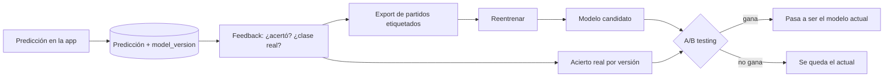

# 7b. MLOps: feedback, reentrenamiento y A/B testing

**Autora:** Eva · **Issues:** #11, #36, #37 · **Estado a 16/11/2026**

Esta sección explica cómo el producto **aprende de su uso**. Cubre tres cosas: el feedback de quien usa la app, la recogida de esos datos para reentrenar y el A/B testing para cambiar de modelo sin riesgo. Las versiones, la promoción manual y el data drift están en la [sección 7a](07a-mlops-flujo-y-drift.md). Los comandos están en [docs/mlops.md](../mlops.md).



## 7b.1 Feedback: la clase real de cada partido

Un modelo entrenado con datos históricos no sabe cómo se comporta con partidos nuevos. La única forma de medirlo es preguntar a quien lo usa.

- Después de cada predicción, la app pregunta **«¿Acertó?»**. Si la respuesta es no, ofrece elegir la clase real y dejar un comentario.
- Cada respuesta se guarda en la tabla `feedback`, ligada a su predicción. Una predicción solo admite un feedback (lo garantiza la base de datos), y el código de guardado rechaza las respuestas incoherentes, como «acertó» con una clase real distinta de la predicha. El esquema está en [docs/database.md](../database.md).
- Cada predicción guarda la **versión del modelo** que la hizo (`model_version`). Así el acierto se mide **por versión**: es lo que permite comparar modelos (apartado 7b.3).
- La página **Historial** muestra el acierto según el feedback: aciertos entre predicciones con feedback, para el modelo actual y para todos.

**Por qué así:** la pregunta tiene dos pasos («¿acertó?» y luego «¿qué clase fue?») para que dar feedback sea rápido. Un «sí» ya es una etiqueta completa, porque la clase real es la predicha. Un «no» sin clase cuenta para el acierto, pero no sirve para reentrenar.

## 7b.2 Recogida de datos para reentrenar (#36)

El briefing pide, en el nivel medio, un pipeline de recolección de datos para futuros reentrenamientos. Cada feedback con clase real es un partido nuevo etiquetado.

```bash
PYTHONPATH=src python -m kiniela.storage.export
```

- Saca de la base de datos (la de producción si `DATABASE_URL` apunta a Neon) los partidos con clase real, y los añade a `data/raw/feedback/labelled_matches.csv`.
- **Equipos y etiqueta como el histórico.** `HomeTeam`, `AwayTeam` y `target` coinciden con el entrenamiento. La marca de tiempo es `predicted_at` (cuándo se predijo), no la fecha del partido: no se une al histórico hasta rellenar `Date` a mano.
- **Incremental.** No repite ningún `prediction_id` que ya esté en el CSV, así que se puede lanzar cada día sin duplicar partidos. Admite filtros por fecha (`--since`) y por versión de modelo (`--model-version`).
- **Fuera de git.** El CSV va a `data/raw/`, que no se versiona: los datos recogidos no acaban en el repositorio.

| Decisión | Alternativa descartada | Por qué |
| --- | --- | --- |
| No repetir por `prediction_id` | Columna «exportado» en la tabla | Sin migraciones, la tabla que ya existe en Neon no recibiría la columna nueva y la app fallaría en producción |
| Solo feedback con clase real | Exportar todos los feedback | Un «falló» sin clase no es una etiqueta |
| Comando, no tarea programada | Cron diario | Con el volumen de un proyecto de curso basta con lanzarlo antes de reentrenar. Un cron añadiría infraestructura sin beneficio |

Antes de mezclar un lote nuevo con el entrenamiento se comprueba el drift con PSI (sección 7a).

## 7b.3 A/B testing y sustitución automática del modelo (#37)

Es el último punto del nivel experto: probar un modelo nuevo con personas reales **sin retirar el actual**, y sustituirlo solo si demuestra que es mejor.

### Cómo funciona

| Pieza | Qué es |
| --- | --- |
| Modelo actual | `models/kiniela_model.joblib` y su ficha `model_card.json` |
| Modelo candidato | `models/candidate_model.joblib` y `candidate_model_card.json`. Cumple el mismo [contrato](../model-contract.md) y tiene otra versión |
| `AB_CANDIDATE_SHARE` | Variable de entorno de 0 a 1: la parte de las predicciones que responde el candidato. Sin definir, todo va al actual |
| Página Historial | Tabla con las dos versiones: F1 macro y gap de validación (de su ficha), predicciones, feedback y acierto |
| `python -m kiniela.models.promote` | Aplica la regla y, si el candidato gana, lo promociona y archiva el anterior en `models/archive/<versión>/` |

En cada predicción, la app sortea qué modelo responde, con la semilla `RANDOM_STATE` del proyecto. La predicción guarda la versión que ha respondido, y la página Predecir la muestra.

### La regla de promoción

El candidato sustituye al actual **solo si se cumplen las cuatro condiciones**:

| # | Condición | Umbral | Por qué |
| --- | --- | --- | --- |
| 1 | Gap train/validación del candidato | < 0,05 | Regla del proyecto contra el sobreajuste |
| 2 | F1 macro de validación del candidato frente al F1 macro de validación del actual (los dos de su ficha) | ≥ actual + 0,01 | F1 macro es la métrica declarada (clases desbalanceadas). El margen evita cambiar de modelo por ruido |
| 3 | Predicciones con feedback por versión | ≥ 30 | Con pocos datos, el acierto real no es fiable |
| 4 | Acierto según el feedback | No menor que el actual | Mejor sobre el papel y no peor con partidos reales |

La regla es una función pura, `should_promote`, que devuelve la decisión y **la lista de condiciones que fallan**. Los umbrales son constantes en [`ab_testing.py`](../../src/kiniela/models/ab_testing.py), por si el equipo acuerda otros. Si el modelo actual es el de prueba, que no tiene ficha, la condición 2 no se puede comparar: el script lo dice y solo cuenta el feedback.

```text
$ PYTHONPATH=src python -m kiniela.models.promote --dry-run
Current: tuned-xgb-2026-11-20 | Candidate: tuned-xgb-2026-12-01
- 'tuned-xgb-2026-12-01' has 12 predictions with feedback; 30 are needed.
Not promoted.
```

Las versiones del ejemplo son ilustrativas: todavía no hay dos modelos reales en producción (apartado 7b.4).

### Por qué la promoción pasa por un PR

En Render, el modelo viaja **dentro de la imagen Docker**, y el disco del contenedor se borra en cada despliegue. Si el script cambiara el modelo dentro del contenedor, el cambio se perdería y nadie lo habría revisado.

Por eso **la decisión es automática, pero la publicación es revisada**: el script cambia los archivos en el repositorio, y el cambio entra como cualquier otro, con PR a `dev`, CI en verde y despliegue. Cada cambio de modelo queda en el historial de Git, y volver atrás es recuperar la versión de `models/archive/`.

| Decisión | Alternativa descartada | Por qué |
| --- | --- | --- |
| F1 macro de validación + feedback | Solo validación | Con solo la validación, el A/B testing no decidiría nada |
| Reparto aleatorio por predicción | Por partido (hash de los equipos) | Reparte el tráfico en la proporción pedida aunque se repitan los partidos. Por partido, con pocos partidos distintos, se descompensa |
| Publicar con PR y despliegue | Cambiar el modelo en el contenedor | El cambio se perdería en el siguiente despliegue y nadie lo habría revisado |

### Calidad

37 tests cubren esta parte ([`tests/test_ab_testing.py`](../../tests/test_ab_testing.py) y dos de la app):

- la regla con casos fijos: gana, empate de F1, sobreajuste, poco feedback, peor acierto real, ficha incompleta y modelo de prueba;
- el reparto: proporción y reproducibilidad;
- el script de punta a punta en una carpeta temporal, incluido el archivado del modelo anterior;
- la app con un candidato que recibe todas las predicciones.

## 7b.4 Límites

- **Sin modelo real todavía.** Mientras no se conecte el modelo final (#35), el A/B testing solo se ha probado con modelos de prueba que cumplen el mismo contrato. El circuito completo está construido: entra un candidato y se puede medir.
- **El feedback depende de que la gente lo dé.** Con 30 respuestas por versión como mínimo, una app con pocas visitas tardará en poder decidir. Es el precio de no decidir con ruido.
- **Reparto por predicción, no por persona.** Una misma persona puede ver predicciones de los dos modelos. En un producto con cuentas de usuario, se repartiría por persona.
- **El feedback no se verifica.** Nadie comprueba que la clase real que alguien indica sea la correcta. Con resultados oficiales, se podría rellenar la clase real automáticamente desde la fuente de datos.
