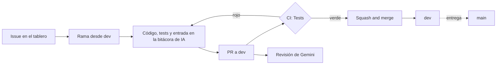

# 8. Forma de trabajo: repositorio, CI y uso de IA

**Borrador:** Eva (#21) · **Para revisar entre todas** · Estado a 13/11/2026

Cómo se organiza el equipo para que cuatro personas, cada una con su asistente de IA, trabajen en el mismo repositorio sin pisarse y con calidad comprobable.

## 8.1 Flujo de una tarea

- **Tablero:** GitHub Projects ([proyecto 56](https://github.com/orgs/IA-P1-BCN/projects/56)). Cada issue tiene responsable, épica y criterios de aceptación.
- **Una tarea = una issue = una rama = un PR.** Las ramas salen de la issue (`gh issue develop`), siempre desde `dev`, con un nombre en inglés.
- **Convenciones:** código, commits y títulos de PR en inglés con [Conventional Commits](https://www.conventionalcommits.org/); documentación en español.

## 8.2 Protección de la calidad

| Mecanismo | Configuración | Por qué |
| --- | --- | --- |
| `dev` protegida | Solo por PR, check `Tests` obligatorio, sin force-push ni borrado, también para las admins | `dev` siempre funciona |
| 0 aprobaciones obligatorias | Cada persona fusiona su PR cuando la CI está en verde | GitHub no deja aprobar un PR propio; el filtro son los tests |
| CI (`.github/workflows/ci.yml`) | `pytest` con `requirements-dev.txt` en cada PR y en cada push a `dev` y `main` | El código funciona en una máquina limpia, no solo en un portátil |
| Revisión con IA (`ai-review.yml`) | Gemini 2.5 Flash comenta cada PR con las reglas del proyecto | Una segunda mirada gratuita. **Solo orienta**: no aprueba ni bloquea, y si falla, el check queda en verde |
| Solo *Squash and merge* | Merge commits y rebase desactivados | Un commit por tarea, con el título del PR |
| Lista de comprobación de PR | En `AGENTS.md` | Título, descripción, `Closes #N`, tests y bitácora en cada PR |

## 8.3 Uso de la IA

- **`AGENTS.md`** recoge las reglas del proyecto para cualquier asistente: estructura, comandos, reglas de ML (sin fuga de datos, `RANDOM_STATE`, gap < 0,05) y lo que nunca debe hacer el agente. Cursor, Copilot y Codex lo leen solos; Claude Code y Gemini CLI, mediante un archivo personal (`CLAUDE.md` o `GEMINI.md`) que lo importa.
- **Bitácora de IA por persona** (`docs/ai-log/<nombre>.md`): en cada PR, qué se pidió al agente, qué se aceptó, qué se rechazó y en qué se equivocó. Un archivo por persona evita los conflictos de un archivo compartido.

| Persona | Herramienta |
| --- | --- |
| Eva | Claude Code (Claude Opus 5.5) |
| Mariana | Cursor |
| Anna | _por completar_ |
| Cala | _por completar_ |

### Errores de la IA que detectamos (ejemplos)

| Situación | Qué pasó | Qué aprendimos |
| --- | --- | --- |
| Preparación de datos (PR #20) | La IA afirmó que football-data.co.uk daba error 404 y generó datos simulados. La web funcionaba: la URL era incorrecta | Verificar lo que afirma la IA antes de construir encima |
| Revisión de Gemini (PR #24) | Señaló como problema un orden de `COPY` en el Dockerfile que era justo el contrario | La revisión de IA orienta, pero no sustituye a la humana |
| Despliegue (#12) | El prompt de configuración de Neon para agentes era para Node.js | Leer antes de ejecutar lo que propone una herramienta |

## 8.4 Lo que mejoraríamos

- Varios PRs entraron con el título o la descripción sin rellenar, y uno sin el código que anunciaba (#43). La lista de comprobación de `AGENTS.md` se añadió para eso. El siguiente paso sería un check automático del título del PR.
- Las tareas necesarias que no estaban en el backlog inicial (#34–#37) se detectaron tarde. Habría que revisar el backlog contra el briefing al empezar cada semana.
