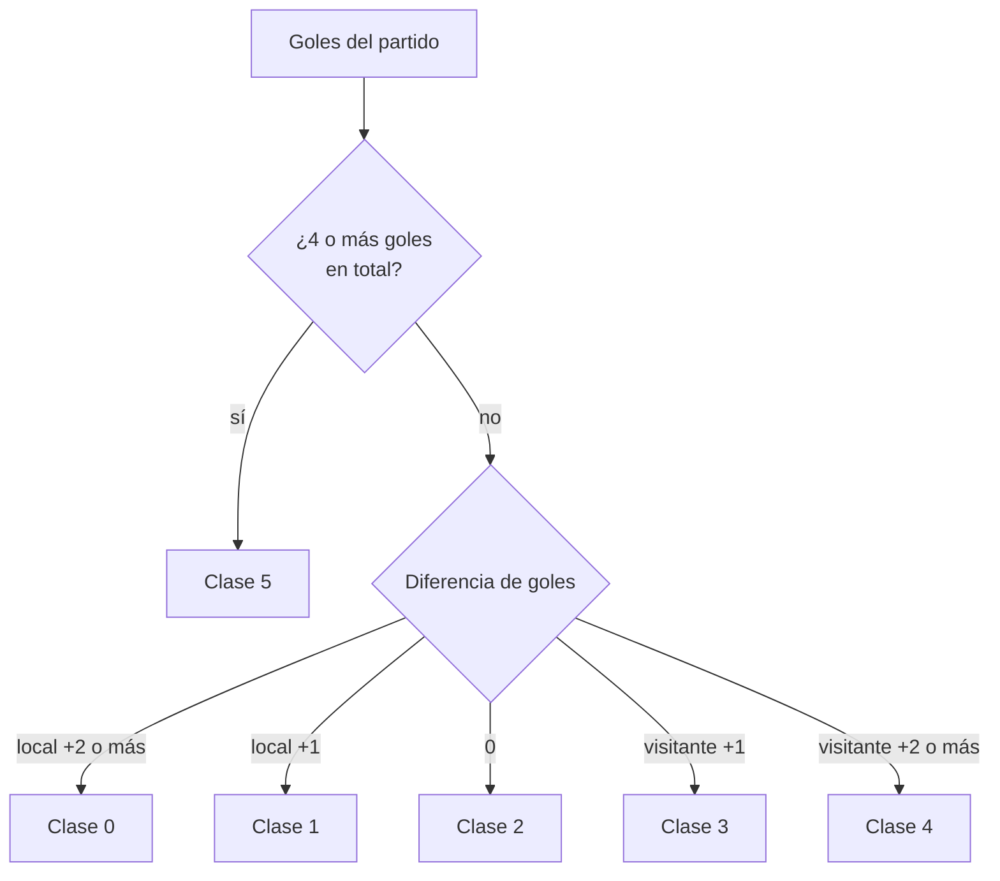

# Presentación técnica · Problema y datos

**Presenta:** Anna · **Duración:** unos 4 minutos (6 diapositivas) · Detalle técnico en las secciones [2](../informe/02-datos-y-eda.md) y [3](../informe/03-features.md) del informe

---

## 1. Qué predecimos

**Se ve:** un partido («Arsenal – Chelsea») y una flecha hacia seis cajas con las clases 0 a 5 y su nombre (`CLASS_NAMES` de `src/kiniela/config.py`).

**Se dice:** «No predecimos solo quién gana, sino qué tipo de resultado será: victoria local clara o ajustada, empate, victoria visitante ajustada o clara, o un partido de muchos goles. Son seis clases, y el modelo devuelve la probabilidad de cada una.»

---

## 2. De dónde salen los datos

**Se ve:** el logo o la URL de football-data.co.uk y tres cifras grandes: **380 partidos · 20 equipos · temporada 2023-24** (11/08/2023 – 19/05/2024).

**Se dice:** «Usamos resultados reales de la Premier League, descargados de football-data.co.uk con `download_premier_league_data`. Se quitan filas incompletas y duplicadas, se normalizan los nombres de los equipos y las fechas se convierten a fecha, porque vienen como día/mes/año. El CSV no se sube al repositorio.»

**Dato:** en esta temporada el local ganó el 46,1 % de los partidos, hubo empate en el 21,6 % y ganó el visitante en el 32,4 %; 3,28 goles por partido.

---

## 3. Cómo se etiqueta cada partido

**Se ve:**

**Se dice:** «La regla está en `build_target` y tiene un orden: primero se mira si hubo 4 o más goles, y eso es clase 5 aunque sea un 2-2 o un 3-1. Si no, una diferencia de 2 goles o más es una victoria clara y el resto son resultados ajustados. La regla está cubierta por tests, caso por caso.»

---

## 4. Clases desbalanceadas

**Se ve:** el gráfico de barras de la distribución de clases del [notebook de EDA](../../notebooks/01_eda.ipynb).

| Clase | 0 | 1 | 2 | 3 | 4 | 5 |
| --- | --- | --- | --- | --- | --- | --- |
| % de partidos | 11,1 | 13,9 | 12,9 | 11,6 | 6,8 | **43,7** |

**Se dice:** «Casi la mitad de los partidos son clase 5, y la victoria visitante clara solo el 6,8 %. Por eso la accuracy engaña: decir siempre "clase 5" ya acierta casi la mitad. Validamos con `StratifiedKFold` y comparamos modelos con F1 macro. Y la frontera es estrecha: hay 80 partidos con 3 goles y 80 con 4, un gol cambia la clase.»

**Captura:** gráfico de barras e histograma de goles con la línea en 4 goles (notebook de EDA, secciones 2 y 3).

---

## 5. Features sin fuga de datos

**Se ve:** una línea de tiempo con el partido a predecir; a la izquierda, los últimos 5 partidos del local en casa y del visitante fuera, marcados en verde; a la derecha y el mismo día, en gris y tachados.

**Se dice:** «El modelo no puede ver el resultado que predice. Cada variable se calcula solo con partidos de fecha anterior: la forma, los goles marcados y la diferencia de goles de los últimos 5 partidos en casa del local y fuera del visitante, más dos combinadas. La app calcula las de un partido nuevo con la misma función que el entrenamiento, y un test comprueba que dan exactamente lo mismo.»

**Dato:** al comparar con partidos reales encontramos que la app no calculaba lo mismo que el entrenamiento. Se corrigió con una función común, y ahora coinciden en los 380 partidos (PR #58).

---

## 6. Qué nos dicen los datos

**Se ve:** la tabla de medias por clase del notebook de EDA, resaltando `match_diff`: 0,44 en la clase 0 y −0,02 en la clase 4.

**Se dice:** «Las variables separan bien la victoria local de la visitante, pero poco el resto; y la clase 5 apenas se distingue con ellas. Con una sola temporada quedan 359 partidos útiles y solo 26 de la clase 4. Eso marca el techo del modelo, y es lo que Cala va a contar ahora con las métricas.»

**Paso a Cala:** modelos, validación y métricas.
