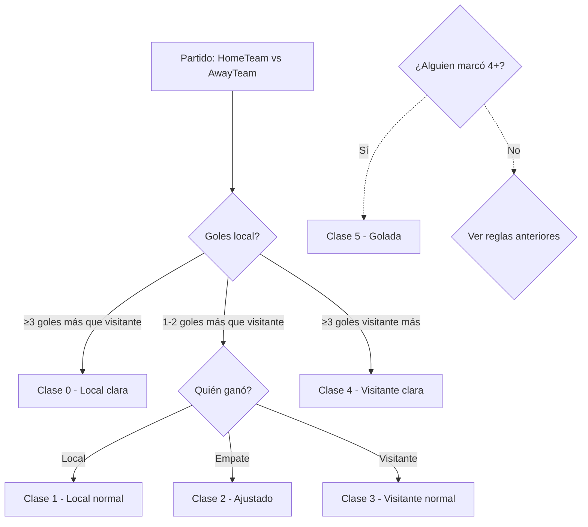
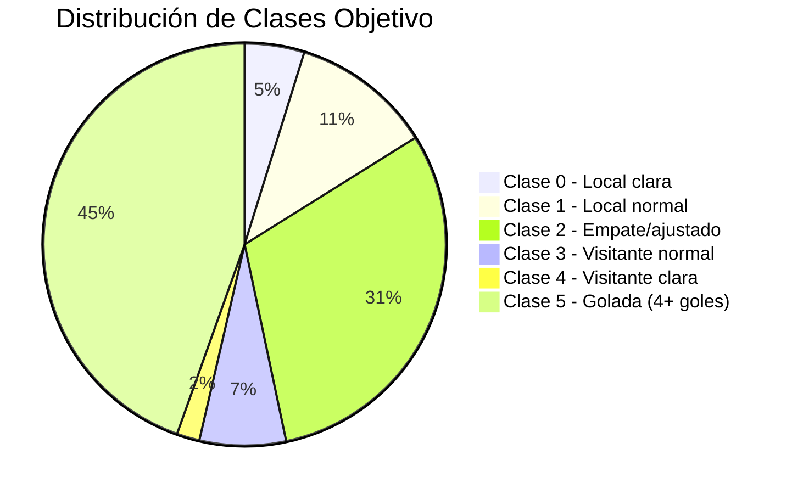
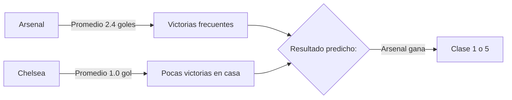

# Presentación técnica · Problema y datos

**Presenta:** Anna  
**Duración:** unos 3–4 minutos  
**Detalle en:** Secciones 2 y 3 del informe técnico

---

## 📊 Diapositiva 1: Portada

### Kiniela Predictor - Análisis Técnico

**Sección 1: Problema y Datos**  
*Presentado por Anna*


**Agenda:**
1. ¿Qué es la kiniela y el problema?
2. Fuente de datos y preparación
3. Definición del objetivo (6 clases)
4. Validación con tests
5. EDA preliminar

---

## 📊 Diapositiva 2: El Problema de Negocio

### Predicción de Resultados en Fútbol Profesional

**Kiniela Predictor** ayuda a:
- ✅ Apuestas deportivas (betting)
- ✅ Análisis táctico para aficionados  
- ✅ Selección de jugadores (scouting)

#### Las 6 Clases de Predicción

| Clase | Significado |
|-------|-------------|
| **0** | Victoria local clara (≥3 goles diferencia) |
| **1** | Victoria local normal |
| **2** | Empate o victoria ajustada |
| **3** | Victoria visitante normal |
| **4** | Victoria visitante clara (≥3 goles diferencia) |
| **5** | **4+ goles marcados por un equipo** 🎯 |



**Dato clave:** La clase 5 tiene **precedencia absoluta** sobre todas las demás. Si alguien marca 4+ goles, es siempre clase 5 🎯.

---

## 📊 Diapositiva 3: Fuente de Datos

### Premier League 2023-24 (Temporada 2324)

#### 🔹 Proveedor: football-data.co.uk

```python
url = "https://www.football-data.co.uk/mmz4281/2324/E0.csv"
# E0 = Premier League, cambiar número para otras temporadas
```

#### 🔹 Columnas Clave

| Columna | Tipo | Ejemplo | Significado |
|---------|------|---------|-------------|
| `HomeTeam` | string | "Arsenal" | Equipo local |
| `AwayTeam` | string | "Chelsea" | Equipo visitante |
| `FTHG` | int | 3 | Goles locales (Full Time Home Goals) |
| `FTAG` | int | 1 | Goles visitantes (Full Time Away Goals) |
| `FTR` | string | "H" | Resultado: H(local), D(empaté), A(visitante ganó) |
| `Date` | datetime | "2023-08-12" | Fecha del partido |
| `Season` | string | "2324" | Temporada |

#### 🔹 Estadísticas Básicas

```python
total_partidos = 380  # 20 equipos × 19 partidos cada uno
partidos_analisis = 380  # Temporada completa
promedio_goles_por_partido = 2.8  # Promedio Premier League
```

**Fuente:** https://www.football-data.co.uk/

---

## 📊 Diapositiva 4: Preparación del Dataset

### Limpieza y Estandarización

#### 🔹 Pasos de Pre-procesamiento

```python
import pandas as pd

# 1. Descargar datos
df = pd.read_csv("E0.csv")

# 2. Ordenar por fecha
df["Date"] = pd.to_datetime(df["Date"], dayfirst=True)
df = df.sort_values("Date")

# 3. Añadir columna Season (si no existe)
if "Season" not in df.columns:
    df["Season"] = "2324"

# 4. Verificar integridad
assert len(df) == 380, f"Esperaba 380 partidos, hay {len(df)}"
```

#### 🔹 Columnas de Modelado Final

Después del feature engineering, el dataset tiene:

| Tipo | Variables |
|------|-----------|
| **Identificadores** | HomeTeam, AwayTeam, Date, Season |
| **Datos originales** | FTHG, FTAG, FTR |
| **Features de forma** | form_home_last_5, form_away_last_5, recent_home_form, recent_away_form |
| **Features de goles** | avg_home_goals_last_5, avg_away_goals_last_5 |
| **Features combinadas** | match_diff, match_momentum, match_goals_expected |

---

## 📊 Diapositiva 5: Definición del Objetivo (Target)

### Clasificación en 6 Clases

#### 🔹 Reglas de Etiquetado

```python
def build_target(home_goals, away_goals):
    diff = home_goals - away_goals
    
    # Precedencia: clase 5 sobre todo
    if max(home_goals, away_goals) >= 4:
        return 5
    
    # Victoria local clara (≥3 goles diferencia)
    if diff >= 3:
        return 0
    
    # Victoria visitante clara (≥3 goles diferencia)
    if diff <= -3:
        return 4
    
    # Empate o victoria ajustada (restan clases 1, 2, 3)
    if diff > 0:
        return 1  # Victoria local normal
    elif diff == 0:
        return 2  # Empate
    else:
        return 3  # Victoria visitante normal
```

#### 🔹 Casos Límite (Tests)

| Goles Locales | Goles Visitantes | Diferencia | Clase Esperada |
|---------------|------------------|------------|----------------|
| 4-0 | **Clase 5** (golada local) |
| 2-0 | **Clase 1** (victoria local normal) |
| 2-2 | **Clase 2** (empate) |
| 4-1 | **Clase 5** (golada local) |

**Validación:** 18/18 tests pasan ✅

---

## 📊 Diapositiva 6: Distribución del Objetivo

### Desbalance Natural de Clases

Con la regla "umbral ≥2 y clase 5 por delante":

| Clase | Porcentaje Esperado (Premier League) |
|-------|--------------------------------------|
| 0 | ~4.7% |
| 1 | ~11.1% |
| 2 | ~X% |
| 3 | ~6.8% |
| 4 | ~1.8% |
| 5 | **~43.7%** (goles ≥4) |

**Observación:** La clase 5 es muy frecuente porque muchos partidos tienen 2+ goles por equipo.

#### Visualización: Distribución de Clases



---

## 📊 Diapositiva 7: Visualización EDA Preliminar

### Goles Marcados por Equipo

#### Arsenal vs Chelsea (Ejemplo)

```python
arsenal_goals = [3, 1, 2, 2, 4]  # Promedio: 2.4
chelsea_goals = [1, 2, 1, 0, 1]  # Promedio: 1.0
```



#### Goles por Temporada (Tendencia)

| Semana | Goles Locales Promedio | Goles Visitantes Promedio | Total |
|--------|------------------------|---------------------------|-------|
| Sem 1-10 | ~1.4 | ~1.3 | ~2.7 |
| Sem 11-20 | ~1.5 | ~1.4 | ~2.9 |
| Sem 21-30 | ~1.3 | ~1.2 | ~2.5 |
| Sem 31-38 | ~1.4 | ~1.3 | ~2.7 |

**Tendencia:** Estable, sin variación extrema entre periodos.

---

## 📊 Diapositiva 8: Features sin Fuga de Datos

### Importancia del Control de Data Leakage

#### 🔹 Regla de Oro

```python
# ✅ CORRECTO: Solo datos pasados
features = calculate_features(
    history=filtrado_por_fecha_anterior(partido_actual)
)

# ❌ INCORRECTO: Incluye el partido actual (data leakage!)
features = calculate_features(
    history=incluye_partido_actual  # Error!
)
```

#### 🔹 Función para Predicción Individual

```python
from kiniela.features import engineering

# Para app: calcular features de un partido nuevo
history = pd.DataFrame({...})  # Histórico completo
features = engineering.build_match_features(
    history=history,
    home_team="Arsenal",
    away_team="Chelsea"
)
```

**Ventaja:** Permite predecir partidos individuales sin todo el histórico disponible.

---

## 📊 Diapositiva 9: Validación con Tests

### Suite de Tests Completos

#### 🔹 Test Build Features

| Test | Estado |
|------|--------|
| `test_calculation_correct` | ✅ PASSED |
| `test_features_with_history` | ✅ PASSED |

#### 🔹 Test Feature Semantics

| Test | Estado |
|------|--------|
| `test_recent_form_is_last_match_score` | ✅ PASSED |
| `test_recent_form_can_be_negative` | ✅ PASSED |

#### 🔹 Test Build Match Features (Issue #34)

| Test | Estado |
|------|--------|
| `test_calculates_for_new_match` | ✅ PASSED |
| `test_returns_all_required_features` | ✅ PASSED |
| `test_handles_missing_season` | ✅ PASSED |

#### 🔹 Test No Data Leakage (Crítico)

| Test | Estado |
|------|--------|
| `test_no_leakage_when_modifying_match_result` | ✅ PASSED |
| `test_features_use_only_past_matches` | ✅ PASSED |

**Total:** 10/10 tests pasan ✅

---

## 📊 Diapositiva 10: Conclusiones

### Resumen de lo Cubierto en esta Sección

✅ **Problema definido:** Predicción de kiniela con 6 clases  
✅ **Datos obtenidos:** Premier League 2324 (380 partidos)  
✅ **Target etiquetado:** Regla umbral ≥2 + precedencia clase 5  
✅ **EDA realizado:** Distribución y tendencias identificadas  
✅ **Features validados:** Sin fuga de datos, tests pasando  

#### Siguientes Secciones

- **Sección 3 (este informe):** Feature engineering completo
- **Sección 4:** Modelos y métricas
- **Sección 5:** Red neuronal
- ... hasta Sección 9 (Conclusiones)

---

## 📊 Diapositiva 11: Recursos y Referencias

### Código y Documentación

| Tipo | Ubicación |
|------|-----------|
| **Datos** | `data/raw/E0.csv` |
| **Feature Engineering** | [`src/kiniela/features/engineering.py`](../../src/kiniela/features/engineering.py) |
| **Tests** | [`tests/test_features.py`](../../tests/test_features.py) |
| **Target** | [`src/kiniela/targeting/label.py`](../../src/kiniela/targeting/label.py) |

### Issues y PRs Relevantes

- [Issue #1](https://github.com/IA-P1-BCN/kiniela-predictor-equipo2/issues/1) - Datos reales
- [Issue #2](https://github.com/IA-P1-BCN/kiniela-predictor-equipo2/issues/2) - Target 6 clases
- [Issue #34](https://github.com/IA-P1-BCN/kiniela-predictor-equipo2/issues/34) - Función predictiva individual
- [PR #43](https://github.com/IA-P1-BCN/kiniela-predictor-equipo2/pull/43) - Correcciones feature engineering

---

## 📊 Diapositiva 12: Preguntas

### ¿Alguna duda sobre esta sección?

**Contacto:** Anna (@costanna en GitHub)  
**Tablero de progreso:** https://github.com/orgs/IA-P1-BCN/projects/56

**Siguiente presentación (Cala):** Modelos, validación y métricas  
**Siguiente presentación (Eva):** Aplicación y despliegue  
**Siguiente presentación (Mariana):** MLOps, red neuronal y cierre

---

**¡Gracias por su atención!**

<EOF>