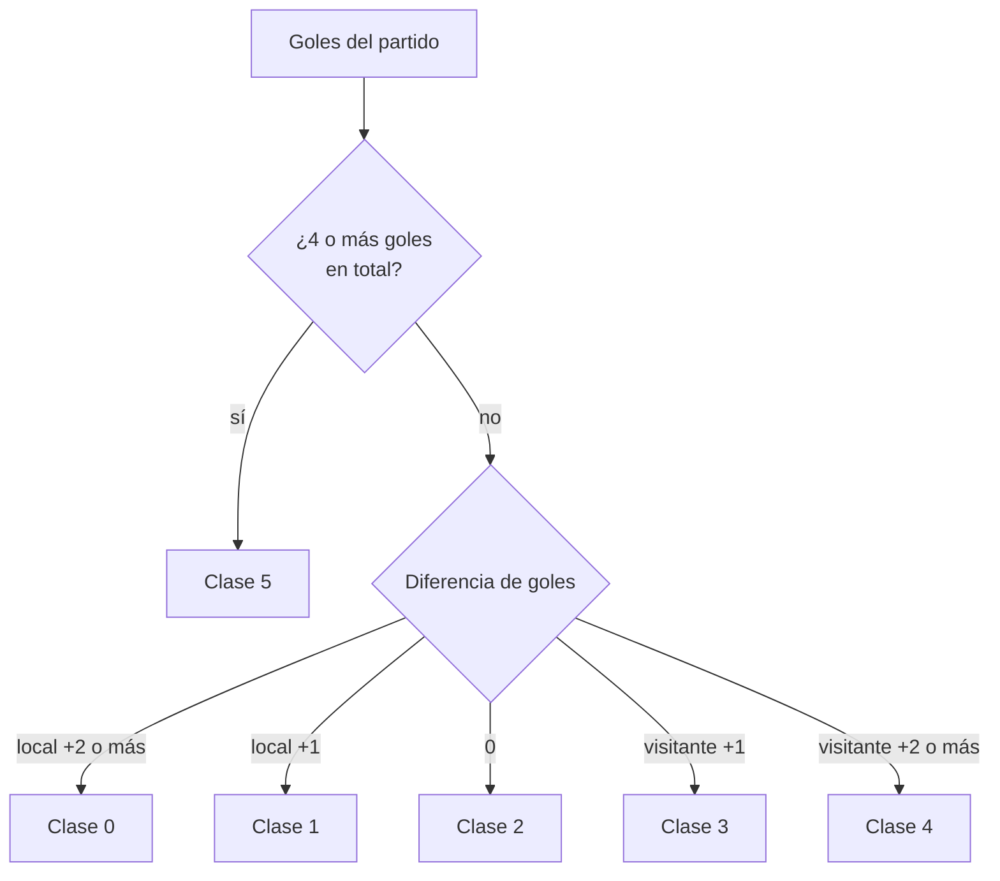

# Presentación técnica · Problema y datos

**Presenta:** Anna · **Duración:** unos 4 minutos (6 diapositivas) · Detalle técnico en las secciones [2](../informe/02-datos-y-eda.md) y [3](../informe/03-features.md) del informe

---

## 1. Qué predecimos

**Se ve:** un partido («Arsenal – Chelsea») y una flecha hacia seis cajas con las clases 0 a 5 y su nombre (`CLASS_NAMES` de `src/kiniela/config.py`).

**Se dice:** «No predecimos solo quién gana, sino qué tipo de resultado será: victoria local clara o ajustada, empate, victoria visitante ajustada o clara, o un partido de muchos goles. Son seis clases, y el modelo devuelve la probabilidad de cada una.»

---

## 2. De dónde salen los datos

**Se ve:** el logo o la URL de football-data.co.uk y dos filas de cifras grandes:

| | Partidos | Equipos | Temporadas |
| --- | --- | --- | --- |
| EDA | 380 | 20 | 2023-24 |
| Modelo final | 3.420 | 33 | 2015-16 a 2023-24 (9) |

**Se dice:** «Usamos resultados reales de la Premier League, descargados de football-data.co.uk con `download_premier_league_data`. Se quitan filas incompletas y duplicadas, se normalizan los nombres de los equipos y las fechas se convierten a fecha, porque vienen como día/mes/año. El análisis lo hicimos con la última temporada; el modelo final se entrena con nueve, y en un momento os cuento por qué.»

**Dato:** en 2023-24 hubo 3,28 goles por partido; la media de las 9 temporadas es 2,82. Fue la temporada con más goles de las nueve.

---

## 3. Cómo se etiqueta cada partido

**Se ve:**

**Se dice:** «La regla está en `build_target` y tiene un orden: primero se mira si hubo 4 o más goles, y eso es clase 5 aunque sea un 2-2 o un 3-1. Si no, una diferencia de 2 goles o más es una victoria clara y el resto son resultados ajustados. La regla está cubierta por tests, caso por caso.»

---

## 4. Clases desbalanceadas

**Se ve:** el gráfico de barras de la distribución de clases del [notebook de EDA](../../notebooks/01_eda.ipynb) y, debajo, la tabla con las dos distribuciones.

| % de partidos | 0 | 1 | 2 | 3 | 4 | 5 |
| --- | --- | --- | --- | --- | --- | --- |
| 2023-24 | 11,1 | 13,9 | 12,9 | 11,6 | 6,8 | **43,7** |
| 9 temporadas | 12,1 | 17,2 | 17,0 | 13,8 | 7,9 | **31,9** |

**Se dice:** «En 2023-24 casi la mitad de los partidos son clase 5. Esa temporada tuvo muchos goles: con las nueve temporadas la clase 5 baja al 32 %, pero sigue siendo la más grande, y la victoria visitante clara sigue siendo la más pequeña. Con este desequilibrio, decir siempre "clase 5" ya acierta mucho sin saber nada; por eso la accuracy engaña, y Carla os contará cómo lo medimos. Además, la frontera es estrecha: en 2023-24 hubo 80 partidos con 3 goles y 80 con 4. Un gol cambia la clase.»

**Captura:** gráfico de barras e histograma de goles con la línea en 4 goles (notebook de EDA, secciones 2 y 3).

---

## 5. Features sin fuga de datos

**Se ve:** una línea de tiempo con el partido a predecir; a la izquierda, los últimos 5 partidos del local en casa y del visitante fuera, marcados en verde; a la derecha y el mismo día, en gris y tachados.

**Se dice:** «El modelo no puede ver el resultado que predice. Cada variable se calcula solo con partidos de fecha anterior: la forma, los goles marcados y la diferencia de goles de los últimos 5 partidos en casa del local y fuera del visitante, más dos combinadas. La app calcula las de un partido nuevo con la misma función que el entrenamiento, y un test comprueba que dan exactamente lo mismo.»

**Dato:** al comparar con partidos reales encontramos que la app no calculaba lo mismo que el entrenamiento. Se corrigió con una función común (#34), y ahora coinciden en los 380 partidos de 2023-24. El modelo final usa esa misma función.

---

## 6. Qué nos dicen los datos

**Se ve:** la tabla de medias por clase del notebook de EDA, resaltando `match_diff`: 0,44 en la clase 0 y −0,02 en la clase 4. Al lado, dos cifras: **26 → 245** partidos útiles de la clase 4 (una temporada → nueve).

**Se dice:** «Las variables separan bien la victoria local de la visitante, pero poco el resto, y la clase 5 apenas se distingue con ellas. Con las nueve temporadas el patrón se mantiene, así que no es casualidad de un año. El problema era la cantidad: con una sola temporada quedaban 359 partidos útiles y solo 26 de la clase 4, muy poco para aprender las clases pequeñas. Con nueve temporadas tenemos 3.235 partidos útiles y 245 de la clase 4. Cuánto mejora el modelo con eso es lo que Carla va a contar ahora con las métricas.»

**Paso a Carla:** modelos, validación y métricas.

---

## Preguntas probables

| Pregunta | Respuesta |
| --- | --- |
| ¿Por qué la clase 5 va antes que las demás? | Es la regla acordada con el equipo: un partido de 4 o más goles es «muchos goles» aunque también sea un empate o una victoria clara. Así cada partido tiene una sola clase |
| ¿Por qué un umbral de 2 goles y no de 3? | Con la clase 5 por delante, un umbral de 3 dejaría la victoria clara solo en el 3-0 y el 0-3, con muy pocos partidos |
| ¿Por qué el EDA es de una temporada y el modelo de nueve? | El EDA se hizo primero, con la temporada más reciente. Al entrenar vimos que una temporada daba muy pocos ejemplos de las clases pequeñas, y añadimos ocho más |
| ¿Por qué no usáis tiros, córners o posesión? | Se conocen al acabar el partido: usarlos sería fuga de datos. Solo usamos lo que se sabe antes |
| ¿Por qué los últimos 5 partidos? | Es lo bastante corto para reflejar la racha y lo bastante largo para no depender de un solo resultado |
| ¿Cómo sabéis que no hay fuga de datos? | Hay tests que cambian el resultado de un partido y comprueban que sus variables no cambian, y otros que fallan si se usan partidos del mismo día |
